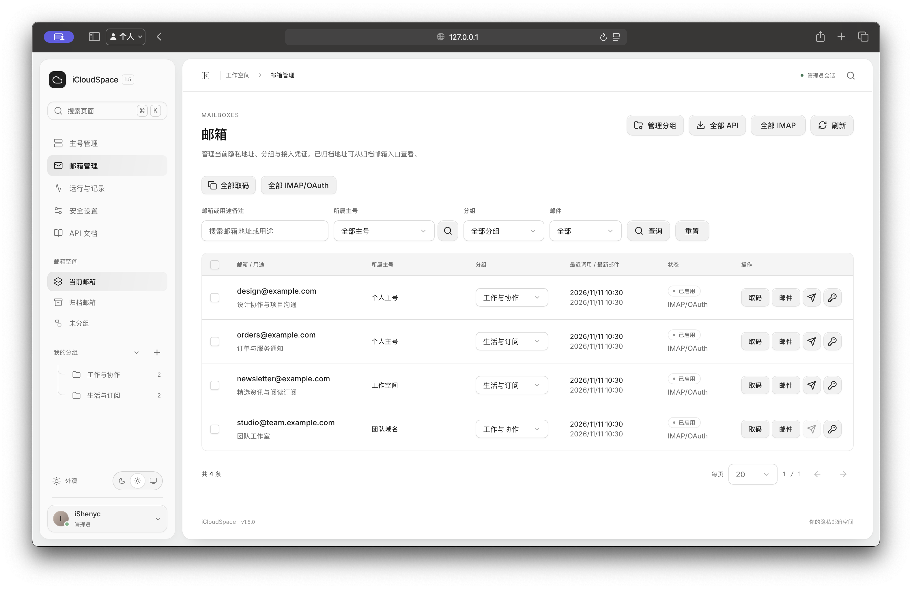
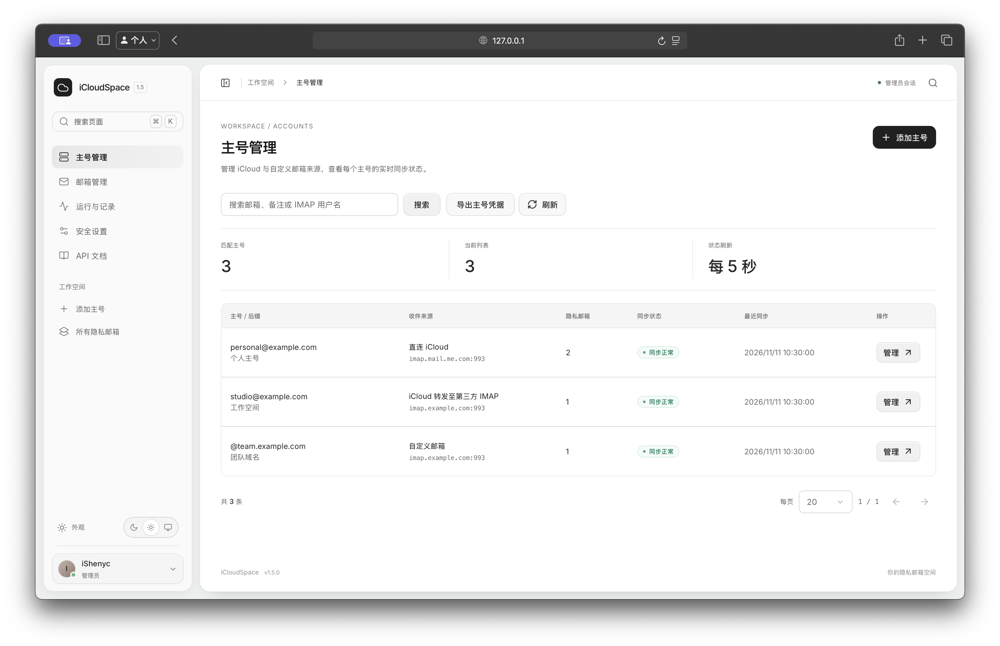
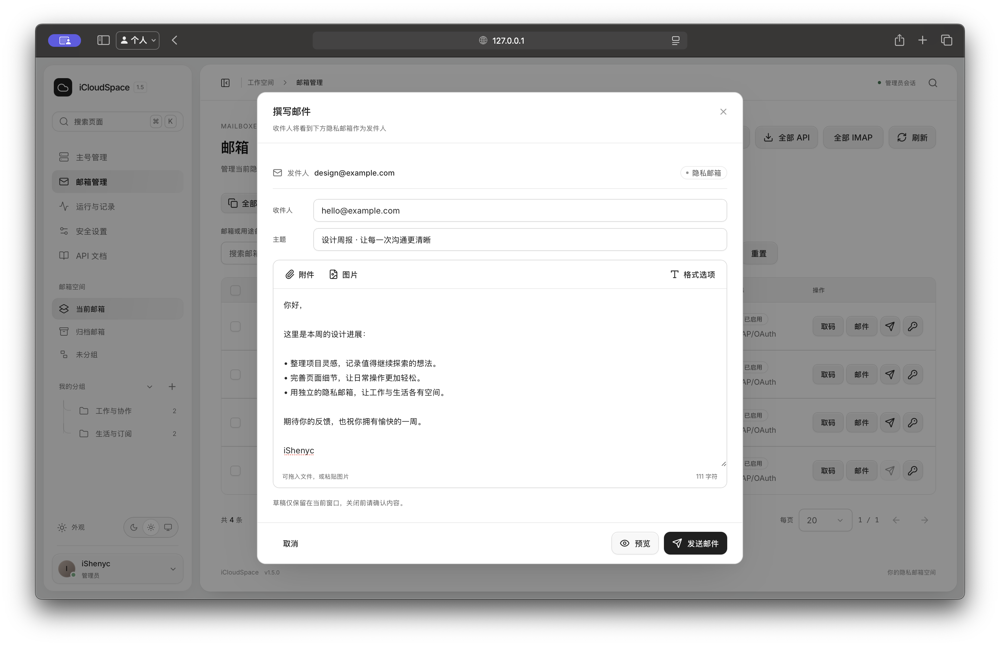

<div align="center">

# iCloudSpace

**A self-hosted workspace for private email addresses**

Current release: **[1.6.0](https://github.com/ishenyc/iCloudSpace/releases/tag/v1.6.0)**.

Connect accounts, organize aliases, and keep mail, credentials and operations in one place.

[简体中文](README.md) · [Installation](docs/installation.md) · [Upgrades & backups](docs/upgrading.md) · [Contributing](CONTRIBUTING.md) · [MIT License](LICENSE)

</div>

<picture>
  <source media="(prefers-color-scheme: dark)" srcset="docs/images/mailboxes-dark.png">
  <source media="(prefers-color-scheme: light)" srcset="docs/images/mailboxes-light.png">
  
</picture>

## Overview

iCloudSpace brings iCloud Hide My Email addresses, IMAP synchronization, mail reading and sending into a single administration interface. Organize addresses by account and purpose, issue separate mailbox credentials, read messages through HTTP or IMAPS, and inspect synchronization and operation records.

Use it with accounts you own or are authorized to manage. This is an independent community project, unaffiliated with Apple. It does not supply email accounts, iCloud+ subscriptions or authorization to use third-party services. The current administration interface is in Simplified Chinese.

## Features

| Capability | Description |
| --- | --- |
| Account management | Manage iCloud and custom IMAP sources, connections, sessions and sync status |
| Private addresses | Manage aliases, search by purpose, organize groups, archive and clean up addresses |
| Mail reading | Browse messages and attachments, extract verification codes and view sanitized HTML |
| Mail composition | Write plain text, Markdown or HTML, attach files and inline images, and inspect submission outcomes |
| Mailbox credentials | Export, revoke and rotate separate API and IMAP/OAuth credentials |
| HTTP and IMAPS | Read codes, latest mail, history and raw views through documented interfaces |
| Operation history | Inspect progress, logs and audit records; query unresolved operations |
| Appearance | Light, dark and system appearance, with desktop and narrow-screen layouts |

Send outcomes distinguish `accepted`, `not_sent` and `unknown`. Acceptance means the upstream accepted the submission; the recipient determines actual delivery. Query the original operation after an unknown outcome instead of submitting again.

## Screenshots

These are complete Safari window captures using fictional demonstration data. Paired images follow the reader's color scheme; clients without picture support show the light version.

### Accounts

<picture>
  <source media="(prefers-color-scheme: dark)" srcset="docs/images/accounts-dark.png">
  <source media="(prefers-color-scheme: light)" srcset="docs/images/accounts-light.png">
  
</picture>

### Mail composition

<picture>
  <source media="(prefers-color-scheme: dark)" srcset="docs/images/compose-dark.png">
  <source media="(prefers-color-scheme: light)" srcset="docs/images/compose-light.png">
  
</picture>

## Getting started

The recommended installation uses Docker Compose v2, Python 3.9+ and OpenSSL. The first build needs access to container registries, npm and Go modules. PostgreSQL 17 stores application data; the application runs as a non-root user.

Clone or download this repository, then run the following from its root. Choose a new private runtime directory **outside the checkout**:

```sh
runtime="$HOME/.local/share/icloudspace"
mkdir -p "$(dirname "$runtime")"
python3 scripts/setup.py --runtime-dir "$runtime"

docker compose --env-file "$runtime/deployment.env" build app
docker compose --env-file "$runtime/deployment.env" --profile setup run --rm --no-deps provision
docker compose --env-file "$runtime/deployment.env" up -d --wait postgres
docker compose --env-file "$runtime/deployment.env" run --rm --no-deps \
  --entrypoint /icloudspace-install app initialize --spec-file /run/space/initialize.json
```

After initialization returns `state: initialized`, enable writes and start the application:

```sh
enable_key=$(python3 -c 'import json,sys; print(json.load(open(sys.argv[1]))["initial_enable_operation"])' "$runtime/installation.json")
docker compose --env-file "$runtime/deployment.env" run --rm --no-deps \
  --entrypoint /icloudspace-install app set-writes --process-file /run/space/process.json \
  --enabled true --expected-revision 1 --operation-key "$enable_key"
docker compose --env-file "$runtime/deployment.env" up -d --wait app
```

Open [http://localhost:8080/admin](http://localhost:8080/admin). The username is `admin`; the generated password is stored in `seed/admin-password` under your private runtime directory. It is never printed or saved in the checkout. Change it after signing in, then connect an account.

Default ports bind only to localhost, and PostgreSQL has no host port. Remote deployment requires an HTTPS reverse proxy and appropriate cookie, proxy and certificate settings. The generated IMAPS certificate is for localhost only. See the [installation guide](docs/installation.md) for configuration and recovery from interrupted setup; the detailed operations guides are currently in Chinese.

## APIs and clients

| Endpoint | Purpose |
| --- | --- |
| `/admin` | Administration workspace |
| `/docs/` | Current code retrieval, mail, OAuth and client instructions |
| `/openapi.json` | OpenAPI description |
| `/api/mail/v1` | Mail resource API |
| IMAPS `1993` | Default localhost client port |

Copy the relevant connection format from a mailbox's details. Mailbox credentials are separate from administrator credentials. Some compatibility endpoints use credentials in URLs: keep these links private and omit query strings from proxy logs. The compatibility `recent` request consumes mail; do not prefetch, cache or automatically retry it.

## Upgrades and data

Keep the same database, content store, configuration and master key across updates. Take a matched backup before an explicit upgrade; never reinitialize an existing installation or replace its master key. Follow the [upgrade guide](docs/upgrading.md).

Credentials are encrypted with the installation master key. Administrator sessions use same-origin validation, HttpOnly cookies and CSRF protection. Mail bodies and the database remain private data: this project does not provide disk-wide or end-to-end encryption. Operators are responsible for host, storage and backup access controls. Report vulnerabilities privately as described in [SECURITY.md](SECURITY.md).

Apple authentication, alias management and sending depend on account status, subscriptions, network access and upstream behavior. Delivery and continued upstream compatibility are not guaranteed.

## Build from source

The frontend uses React, TypeScript, Vite and shadcn/ui; the backend uses Go and PostgreSQL. `.nvmrc` and `backend/go.mod` declare the required toolchain versions.

```sh
npm --prefix frontend ci
npm --prefix frontend run check
npm --prefix frontend run build
(cd backend && go build ./...)
```

Application and offline administration commands live in `backend/cmd/`. SQL schema migrations for installation and future upgrades are included. Local databases, test datasets, investigation notes and real runtime configuration are excluded.

## Contributing and maintenance

See [CONTRIBUTING.md](CONTRIBUTING.md) before opening a focused issue or pull request. Remove real addresses, access-bearing links and credentials. The repository includes build and public-file checks, dependency update configuration and version-tag workflows that build Linux release archives.

## License

Original project code is licensed under the [MIT License](LICENSE), Copyright © 2026 **iShenyc**. Third-party code, fonts and icons retain their original authors and licenses; see [THIRD_PARTY_NOTICES.md](THIRD_PARTY_NOTICES.md). Apple, iCloud and other names belong to their respective owners.
