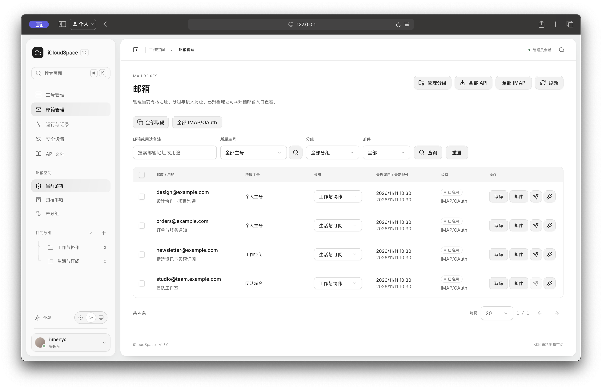
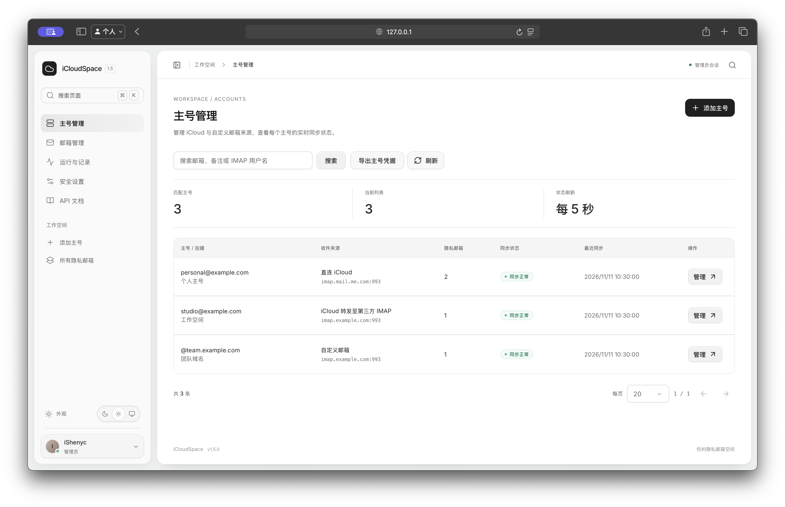
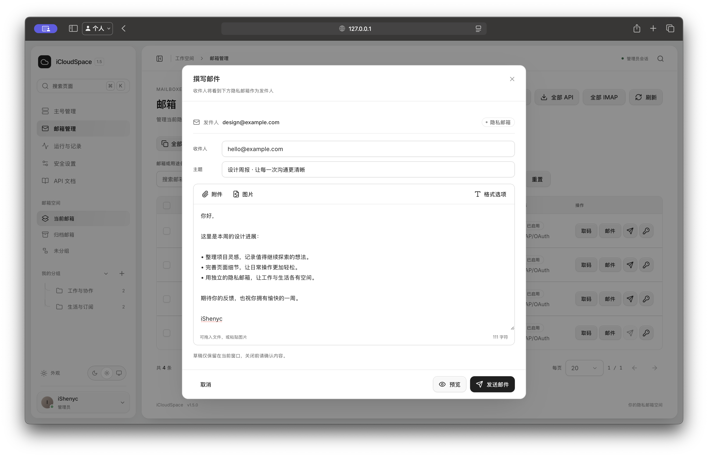

<div align="center">

# iCloudSpace

**自托管的隐私邮箱管理工作台**

当前公开发行版本为 **[1.6.0](https://github.com/ishenyc/iCloudSpace/releases/tag/v1.6.0)**。

连接主号，管理隐私地址，让邮件、凭据与每一次操作都有清晰的归属。

[English](README.en.md) · [安装指南](docs/installation.md) · [更新与备份](docs/upgrading.md) · [贡献指南](CONTRIBUTING.md) · [MIT 许可证](LICENSE)

</div>

<picture>
  <source media="(prefers-color-scheme: dark)" srcset="docs/images/mailboxes-dark.png">
  <source media="(prefers-color-scheme: light)" srcset="docs/images/mailboxes-light.png">
  
</picture>

## 简介

iCloudSpace 将 iCloud 隐藏邮件地址、IMAP 收件、邮件阅读和发送集中到一个管理界面。你可以按主号和用途组织邮箱，为地址分配独立接入凭据，通过 HTTP API 或 IMAPS 读取邮件，并查看同步与操作记录。

项目适合管理自己拥有或获授权使用的邮箱。它是独立的社区项目，不隶属于 Apple，也不提供邮箱账户、iCloud+ 订阅或第三方服务授权。

## 功能

| 能力 | 说明 |
| --- | --- |
| 主号管理 | 管理 iCloud 与自定义 IMAP 来源，查看连接、会话和同步状态 |
| 隐私邮箱 | 同步和管理隐藏邮件地址，按用途分组、搜索、归档和清理 |
| 邮件阅读 | 查看邮件列表、正文与附件，读取验证码，提供经过清理的 HTML 预览 |
| 邮件发送 | 撰写纯文本、Markdown 或 HTML，添加附件与行内图片，查看明确的提交结果 |
| 独立凭据 | 按邮箱管理 API、IMAP/OAuth 接入凭据，支持导出、撤销和轮换 |
| HTTP 与 IMAPS | 提供取码、最新邮件、历史邮件、原文读取及客户端接入能力 |
| 操作可追踪 | 查看同步进度、运行日志与审计记录，保留待确认操作的查询入口 |
| 深浅色界面 | 支持浅色、深色和跟随系统，适配桌面与窄屏操作 |

发送结果区分 `accepted`、`not_sent` 和 `unknown`。`accepted` 表示上游接受提交，实际收达仍由收件端确认；`unknown` 应查询原操作，不能自动重复发送。

## 界面预览

截图采用 Safari 的完整窗口，使用虚构展示数据。深浅色图片会根据阅读环境自动切换；不支持主题图片的客户端显示浅色版本。

### 主号管理

集中查看来源类型、连接状态和邮箱数量，从主号进入同步与会话管理。

<picture>
  <source media="(prefers-color-scheme: dark)" srcset="docs/images/accounts-dark.png">
  <source media="(prefers-color-scheme: light)" srcset="docs/images/accounts-light.png">
  
</picture>

### 邮件撰写

收件人、正文、附件和预览集中在同一工作流中，发送状态与后续查询保持可见。

<picture>
  <source media="(prefers-color-scheme: dark)" srcset="docs/images/compose-dark.png">
  <source media="(prefers-color-scheme: light)" srcset="docs/images/compose-light.png">
  
</picture>

## 快速开始

推荐使用 Docker Compose。需要 Docker Compose v2、Python 3.9+ 和 OpenSSL；首次构建需要访问容器镜像、npm 和 Go 模块仓库。数据使用 PostgreSQL 17，应用容器以非 root 用户运行。

克隆或下载本仓库后，在仓库根目录执行。`runtime` 必须指向仓库之外、尚不存在的私有目录：

```sh
runtime="$HOME/.local/share/icloudspace"
mkdir -p "$(dirname "$runtime")"
python3 scripts/setup.py --runtime-dir "$runtime"

docker compose --env-file "$runtime/deployment.env" build app
docker compose --env-file "$runtime/deployment.env" --profile setup run --rm --no-deps provision
docker compose --env-file "$runtime/deployment.env" up -d --wait postgres
docker compose --env-file "$runtime/deployment.env" run --rm --no-deps \
  --entrypoint /icloudspace-install app initialize --spec-file /run/space/initialize.json
```

确认初始化返回 `state: initialized` 后，启用并启动应用：

```sh
enable_key=$(python3 -c 'import json,sys; print(json.load(open(sys.argv[1]))["initial_enable_operation"])' "$runtime/installation.json")
docker compose --env-file "$runtime/deployment.env" run --rm --no-deps \
  --entrypoint /icloudspace-install app set-writes --process-file /run/space/process.json \
  --enabled true --expected-revision 1 --operation-key "$enable_key"
docker compose --env-file "$runtime/deployment.env" up -d --wait app
```

管理入口为 [http://localhost:8080/admin](http://localhost:8080/admin)。用户名是 `admin`，首次密码保存在私有目录的 `seed/admin-password` 文件中，不会写入源码或输出到终端。登录后修改管理员密码，再添加邮箱账户。

默认仅监听本机端口，PostgreSQL 不对宿主机发布端口。远程访问需要 HTTPS 反向代理及正确的 Cookie、代理和证书设置；生成的 IMAPS 证书仅供 localhost 使用。详细步骤、失败处理和配置说明见[安装指南](docs/installation.md)。

## API 与客户端

运行实例内置与当前版本匹配的使用说明和接口描述：

| 入口 | 用途 |
| --- | --- |
| `/admin` | 管理工作台 |
| `/docs/` | 取码、邮件读取、OAuth 与客户端使用说明 |
| `/openapi.json` | OpenAPI 描述 |
| `/api/mail/v1` | 邮件资源 API |
| IMAPS `1993` | 默认本机客户端接入端口 |

在邮箱详情中取得对应接入格式；不要将邮箱凭据当作管理员登录凭据。部分兼容接口通过 URL 传递访问凭据，应避免将完整链接写入代理日志或公开分享。兼容 `recent` 请求会消费邮件，只能显式调用，不要预加载、缓存或自动重试。

## 更新与数据

更新时沿用同一安装的数据库、正文、配置和主密钥，先备份，再执行显式升级。不要为已有安装重新初始化，也不要用新密钥替换现有密钥。详见[更新与备份](docs/upgrading.md)。

凭据使用安装主密钥加密，管理会话采用同源校验、HttpOnly Cookie 和 CSRF 保护。邮件正文与数据库仍属于私密数据，项目不提供全盘或端到端加密；宿主机、存储和备份的访问控制由部署者负责。安全问题请按 [SECURITY.md](SECURITY.md) 私下报告。

Apple 登录、隐藏邮件地址和发信能力受账户状态、订阅、网络以及上游接口变化影响。项目不保证邮件投递或上游服务长期不变。

## 从源码构建

前端使用 React、TypeScript、Vite 和 shadcn/ui；后端使用 Go 与 PostgreSQL。Node 版本见 `.nvmrc`，Go 版本见 `backend/go.mod`。

```sh
npm --prefix frontend ci
npm --prefix frontend run check
npm --prefix frontend run build
(cd backend && go build ./...)
```

应用与离线管理命令位于 `backend/cmd/`。公开源码包含新安装和后续升级所需的 SQL 结构迁移，不包含本地数据库、测试数据、调试记录或真实运行配置。

## 参与与维护

欢迎提交问题和聚焦的改进。提交前请阅读[贡献指南](CONTRIBUTING.md)，移除真实邮箱、访问链接和任何凭据。仓库提供构建检查、公开文件边界检查、依赖更新配置及按版本标签生成 Linux 发布归档的工作流。

## 许可证

项目自有代码采用 [MIT License](LICENSE)，Copyright © 2026 **iShenyc**。第三方代码、字体与图标保留各自的作者和许可证，详见 [THIRD_PARTY_NOTICES.md](THIRD_PARTY_NOTICES.md)。Apple、iCloud 及其他名称属于其各自权利人。
